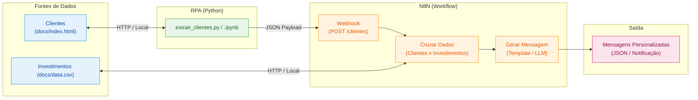

# Assistente de Investimentos com RPA e IA Generativa

[](https://colab.research.google.com/github/christianocassio/n8nFinalmente/blob/main/rpa/extrair_clientes.ipynb)
[](https://colab.research.google.com/drive/1nwUySmKhXc7v4Ni8J95xFbL8chbyNUGZ?usp=sharing)

Pipeline de automação inteligente combinando técnicas de **RPA (Robotic Process Automation)** em Python com orquestração de fluxos e **IA Generativa no N8N**.

---

## 🎯 Objetivo do Projeto

Desenvolver um pipeline automatizado de recomendação de investimentos:
1. **RPA (Extração):** Coletar dados de clientes simulados via web scraping em Python.
2. **Orquestração (N8N):** Processar os dados via Webhook e cruzar perfis com uma base de produtos de investimento (`data.csv`).
3. **Personalização (IA / Templates):** Gerar recomendações personalizadas para cada cliente conforme perfil de risco e saldo.

---

## 🏗️ Arquitetura do Projeto



---

## 📁 Estrutura do Repositório

```text
n8n-assistente-investimentos/
├── .env.example                # Variáveis de ambiente configuráveis
├── .gitignore                  # Regras de exclusão do Git
├── README.md                   # Documentação do projeto
├── requirements.txt            # Dependências Python (requests, beautifulsoup4, python-dotenv)
├── docs/
│   ├── data.csv                # Matriz de produtos de investimentos por perfil
│   └── index.html              # Página simulada com tabela de clientes
├── n8n/
│   ├── README.md               # Guia de importação dos workflows
│   ├── workflow.json           # Workflow N8N com mensagens por regras
│   └── workflow_gemini.json    # Variante com geração de mensagens via Gemini
└── rpa/
    ├── extrair_clientes.ipynb  # Notebook para execução no Colab / Jupyter
    └── extrair_clientes.py     # Script Python para execução autônoma via CLI
```

---

## 📊 Matriz de Investimentos Cadastrada (`docs/data.csv`)

| Perfil | Produto | Aporte Mínimo | Rentabilidade |
| :--- | :--- | :---: | :--- |
| **Conservador** | Poupança | R$ 100,00 | 6.2% a.a. |
| **Conservador** | Tesouro Selic | R$ 500,00 | 13.0% a.a. |
| **Conservador** | CDB Liquidez Diária | R$ 1.000,00 | 12.5% a.a. |
| **Moderado** | CDB Prefixado | R$ 1.000,00 | 14.0% a.a. |
| **Moderado** | Tesouro IPCA+ | R$ 1.000,00 | IPCA + 6.0% |
| **Moderado** | Fundo Multimercado | R$ 5.000,00 | 16.0% a.a. |
| **Arrojado** | Criptomoedas | R$ 100,00 | Variável |
| **Arrojado** | Ações ETF | R$ 500,00 | Variável |
| **Arrojado** | Fundo de Ações | R$ 10.000,00 | Variável |

---

## 🚀 Como Executar

### 1. Clonar o Repositório e Configurar Ambiente
```bash
git clone https://github.com/christianocassio/n8nFinalmente.git
cd n8nFinalmente

# Criar ambiente virtual (opcional, recomendado)
python -m venv .venv
# Ativar no Windows PowerShell:
.venv\Scripts\Activate.ps1

# Instalar dependências
pip install -r requirements.txt

# Configurar variáveis de ambiente
cp .env.example .env
```

### 2. Configurar o Workflow no N8N
1. Escolha e importe `n8n/workflow.json` (mensagens por regras) ou `n8n/workflow_gemini.json` (mensagens geradas pelo Gemini).
2. Para a variante Gemini, configure sua chave de API no nó **Consultor IA (Google Gemini)**, substituindo `COLE_SUA_API_KEY_AQUI` na URL. Não compartilhe nem versione sua chave.
3. Ative o workflow ou utilize o endpoint de teste (`/webhook-test/clientes`).
4. Copie a URL do Webhook e adicione no arquivo `.env` ou execute o script com o parâmetro `--webhook-url`.

### 3. Executar o Script RPA
```bash
# Execução padrão (lê .env)
python rpa/extrair_clientes.py

# Simulação sem envio (Dry-Run)
python rpa/extrair_clientes.py --dry-run

# Execução informando webhook explicitamente
python rpa/extrair_clientes.py --webhook-url "http://localhost:5678/webhook/clientes"
```

---

## 📋 Status dos Entregáveis

- [x] Repositório Git configurado e integrado ao GitHub (`n8nFinalmente`)
- [x] Estrutura padronizada de diretórios (`docs/`, `rpa/`, `n8n/`)
- [x] Arquivo de dependências (`requirements.txt`) e `.env.example`
- [x] Script RPA autônomo com extração e envio via POST (`rpa/extrair_clientes.py`)
- [x] Notebook Jupyter parametrizado (`rpa/extrair_clientes.ipynb`)
- [x] Workflow N8N exportado e documentado (`n8n/workflow.json`)
- [x] Variante de workflow com geração via Google Gemini (`n8n/workflow_gemini.json`)
- [x] Regras de cruzamento de clientes x investimentos com aporte mínimo
- [x] Geração de mensagens consultivas personalizadas por perfil
- [x] Documentação técnica de integração com IA Generativa (LLMs)

---

## 📦 Versões

Consulte as versões publicadas na página de [Releases do GitHub](https://github.com/christianocassio/n8nFinalmente/releases).

A versão inicial `v1.0.0` reúne o fluxo RPA com envio ao webhook do N8N, o workflow exportável e a documentação de execução e integração.
