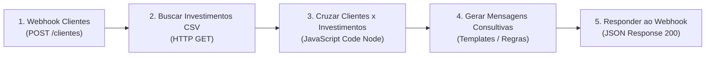

# Workflow N8N: Assistente de Investimentos

Este diretório contém a definição exportada do fluxo de automação para o N8N ([`workflow.json`](./workflow.json)).

---

## 🏗️ Arquitetura do Fluxo

O workflow é composto pelos seguintes nós conectados em sequência:



### Detalhamento dos Nós:
1. **Webhook Clientes (`POST /webhook/clientes` ou `/webhook-test/clientes`):**
   - Recebe a requisição JSON enviada pelo RPA com a lista de clientes extraídos.
   - Configurado em modo `Respond to Webhook` para devolver a resposta final do processamento.
2. **Buscar Investimentos CSV (`HTTP Request`):**
   - Faz o download automático da base de produtos em `data.csv`.
3. **Cruzar Clientes x Investimentos (`Code Node`):**
   - Faz o parse das linhas do CSV.
   - Cruza o perfil de cada cliente (`Conservador`, `Moderado`, `Arrojado`) com os produtos compatíveis.
   - Valida se o saldo disponível cobre o aporte mínimo de cada investimento.
4. **Gerar Mensagens Consultivas (`Code Node`):**
   - Cria uma mensagem personalizada e humanizada com tom de assessoria de investimentos, listando rentabilidades, aportes mínimos e orientações estratégicas.
5. **Responder ao Webhook (`Respond to Webhook`):**
   - Devolve um payload JSON consolidado com status, total processado e lista de mensagens geradas.

---

## 🤖 Como Adicionar IA Generativa (Desafio Extra)

Para substituir ou enriquecer as mensagens com IA Generativa (Google Gemini, OpenAI GPT ou Anthropic Claude):

1. No N8N, adicione o nó **AI Agent** ou **OpenAI / Google Gemini Model**.
2. Conecte a saída do nó `Cruzar Clientes x Investimentos` ao agente.
3. Utilize o seguinte System Prompt de referência:
   ```text
   Você é um assessor de investimentos sênior e atencioso.
   Com base nos dados do cliente (Nome: {{$json.cliente.nome}}, Perfil: {{$json.cliente.perfil}}, Saldo: {{$json.cliente.saldo}})
   e na lista de produtos compatíveis com o perfil dele:
   {{JSON.stringify($json.produtos_recomendados)}}
   
   Escreva uma mensagem consultiva, empática e motivadora sugerindo uma estratégia de alocação de recursos adequada à realidade dele. Seja claro sobre prazos, riscos e rentabilidades esperadas.
   ```
4. Configure sua chave de API nas credenciais do N8N (`GEMINI_API_KEY` ou `OPENAI_API_KEY`).

---

## 📥 Como Importar no N8N

1. Acesse sua instância do N8N (Cloud ou Local).
2. No menu lateral, clique em **Workflows** > botão **Add Workflow** (ou ícone de três pontos `...` no canto superior direito).
3. Selecione **Import from File...** e escolha [`workflow.json`](./workflow.json).
4. Clique em **Save** e ative o botão **Active** (ou teste via **Test step / Listen for event**).
